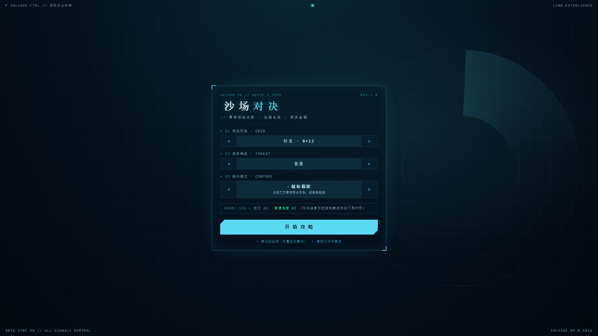
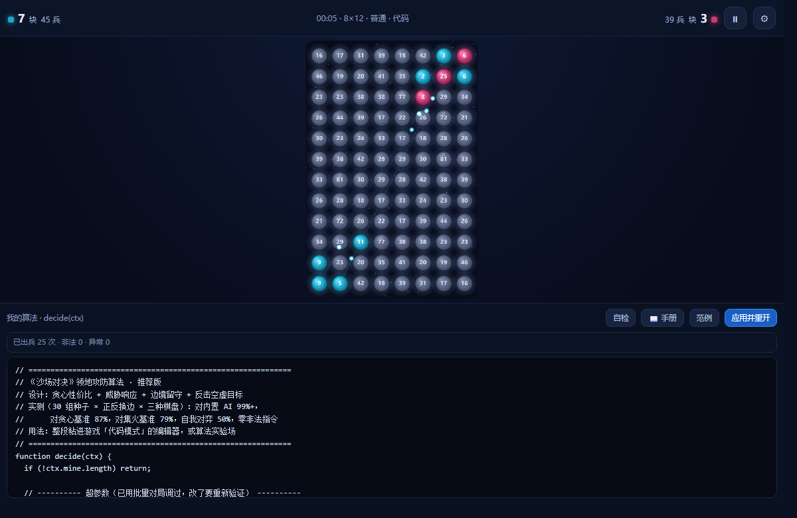
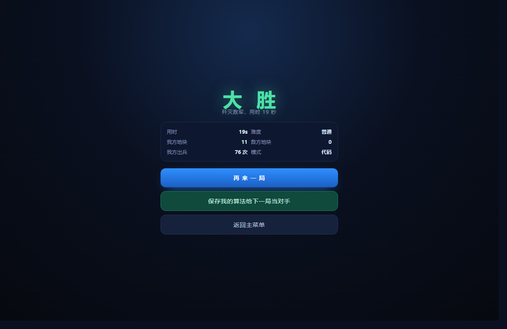

# 沙场对决 · 星球领地攻防

> 一款可直接游玩、也可以「写代码操控」的领地攻防策略游戏。
> 灵感来自 State.io 类小游戏：扩张领地、对冲兵力、滚雪球推平对手——但把胜负交给你写的算法。



## 这是什么

- **想玩**：鼠标 / 触屏拖拽出兵，三种棋盘、三档 AI 难度，随时暂停调速、随手缩放画面。
- **想写算法**：切到「代码指挥」模式，用 `decide(ctx)` 控制全部星球，看你的算法打完整场。
- **想验证算法**：内置**确定性引擎 + 批量跑测**，同一份代码同一种子必得同样结果，公平性经过对称性校验。

| 主菜单 | 代码模式对战中 | 胜利结算 |
| --- | --- | --- |
|  |  |  |

## 快速开始

**方式一：直接玩（零依赖）**

用 Chrome / Edge 打开 `index.html` 即可，无需服务器、无需构建。

**方式二：安装 Windows 桌面版**

从 [Releases](../../releases) 下载 `ShachangShowdown-Setup-x.y.z.exe`，双击安装。
（Electron 38 封装，含开始菜单快捷方式与卸载器；打包方法见 [desktop/BUILD.md](desktop/BUILD.md)）

**方式三：算法实验场**

打开 `algo-lab/index.html`——左侧写代码，右侧实时预览，下方批量跑测出胜率矩阵，一键复制 Markdown 战报。

## 界面与操作

主菜单的三项设置都是**单选循环器**：只显示当前选项，点 `◀` `▶` 切换，到头自动回绕（如「小」再往左就是「大」）。选择自动记忆，下次打开还是上次的配置。

| 设置 | 可选值 |
| --- | --- |
| 01 棋盘网格 | 小 6×9 / 标准 8×12 / 大 10×15（城池数量随之 2 / 3 / 4） |
| 02 威胁等级 | 简单 / 普通 / 困难（决策间隔、侵略系数、集火规模、是否回防依次加强） |
| 03 操作模式 | 鼠标指挥 / 触屏指挥 / 代码指挥 |

配置完点 **开始攻略** 进入对局。

### 画面缩放

| 操作 | 方式 |
| --- | --- |
| 缩放（鼠标） | 滚轮，以光标位置为锚点（指哪放大哪），范围 1×～3.5× |
| 缩放（触屏） | 双指捏合；双指拖动可同时平移 |
| 平移 | 空白处按住拖动（鼠标/单指均可），自动钳制边界 |
| 复位 | 点左下角 `ZOOM` 读数，或按键盘 `0` |

放大后位图分辨率同步提升，星球和兵力数字不会变糊；点选与拖拽的命中判定在缩放后依然精确。

### 兵力调节

出兵比例决定从选中星球抽多少驻军（10%～100%，步进 5%）：

- **桌面**：底部比例滑杆，两侧 `−` `+` 按钮**长按可连续加减**，也可用键盘 `+` / `-`
- **移动端**：屏幕**右侧固定竖向兵力条**，上 `+` 下 `−`，中间竖轨可直接拖动，与底部滑杆实时同步；出现时棋盘自动左移让位

### 快捷键

| 按键 | 作用 |
| --- | --- |
| `空格` | 暂停 / 继续 |
| `Esc` | 打开 / 关闭设置面板 |
| `+` `-` | 出兵比例 ±5% |
| `0` | 缩放复位 |

## 三种操作模式

| 模式 | 说明 |
| --- | --- |
| 鼠标指挥 | 点选己方星球再点目标，或直接拖拽；拖动途中扫过其他星球可多路齐发 |
| 触屏指挥 | 手指按住拖到目标松手，支持一次扫过多块；配套右侧兵力条 |
| 代码指挥 | 写 `decide(ctx)` 自动指挥全场；编辑器带 API 手册、一键插入片段、8 局自检与实时报错状态条 |

## 代码模式 · API 速查

`decide(ctx)` 每 0.2 秒被调用一次，每次最多 4 条 `ctx.send` 指令：

```js
function decide(ctx) {
  if (!ctx.mine.length) return;

  // 从兵最多的地块出兵
  const src = ctx.mine.slice().sort((a, b) => b.troops - a.troops)[0];
  if (!src || src.troops < 20) return;            // 兵太少，先攒

  // 找打得起、驻军最少的目标
  let best = null;
  for (const t of ctx.cells) {
    if (t.owner === ctx.me) continue;             // 自己的地不打
    if (t.troops + 3 > src.troops) continue;      // 打不起就不打
    if (!best || t.troops < best.troops) best = t;
  }
  if (best) ctx.send(src.id, best.id, 0.7);       // 抽 70% 兵力去打
}
```

| 字段 / 方法 | 类型 | 说明 |
| --- | --- | --- |
| `ctx.mine / enemies / neutrals / cells` | 数组 | 我方 / 敌方 / 中立 / 全部地块 |
| `ctx.incoming` | 数组 | 正打向我的敌军 `{to, from, amount, eta}` |
| `ctx.ordersLeft` | 数字 | 本轮剩余指令数（初始 4） |
| `ctx.me` | 数字 | 我方编号（每局随机，别写死） |
| `ctx.dist(a, b)` | 函数 | 两地块格距 |
| `ctx.eta(a, b)` | 函数 | 飞行耗时（秒，= 格距 × 0.3） |
| `ctx.send(from, to, ratio)` | 函数 | 出兵，ratio ∈ (0,1] 按当前驻军比例抽取 |
| `ctx.rand()` | 函数 | 种子化随机 [0,1) |

地块对象：`{id, c, r, owner, troops, cap, rate, type}`——
普通星球 `cap 110 / 1.9 兵每秒`，城池 `cap 180 / 3.4 兵每秒`，`type` 为 `'plain' | 'city'`。

游戏内点 **手册** 可查看完整文档、报错对照表和四个可一键插入的片段（救火增援 / 集火 / 边境留守 / 打分选目标）；点 **自检** 会用当前棋盘和难度跑 8 局并给出战绩与违规报告；编辑器下方常驻状态条实时显示「已出兵次数 · 非法指令 · 异常」。

## 内置推荐算法

`algo/recommended-algo.js` 是一套调好参的参考实现（贪心性价比 + 威胁响应 + 边境留守 + 反击空虚目标），
游戏内点「范例」即可一键载入编辑器。40 种子 × 换边对战 × 三种棋盘的诚实评估：

| 对手 | 胜率 |
| --- | --- |
| easy / normal 内置 AI、turtle / random 基准 | 100% |
| hard 内置 AI | 98.8% |
| greedy（贪心基准） | 86.3% |
| swarm（集火基准） | 73.8% |
| 自我对弈 | 50%（公平性校验） |
| 非法指令 | 0 |

已知短板：对「集火弱点」型对手约 74%，参数扫描已到平台期，进一步提升需要预测对手意图的结构性改动。

## 界面风格

整套 UI 是「深海打捞作业终端」的工业仪表盘语言：冰青单色 `#5ee6ff` + 深海黑、等宽字体贯穿、
直角面板配四角准星、斜切角主按钮、编号标签（`01 棋盘网格 · GRID`）、网格底纹与 CRT 扫描线、右侧缓慢旋转的声呐环。
没有渐变发光大标题，也没有圆角卡片和 emoji 图标。

## 目录结构

```
├── index.html            # 游戏主入口（菜单 / 对局 / 设置 / 结算 / 代码编辑器）
├── engine/
│   ├── sim.js            # 确定性模拟内核（固定步长 0.05s，Node/浏览器双用）
│   └── bots.js           # 内置 AI（三档难度）+ 基准 bot（random/greedy/swarm/turtle）
├── algo-lab/             # 算法实验场：编辑、预览、批量跑测、战报导出
├── algo/                 # 推荐算法 + 调参脚本（tune.js / eval.js）
├── desktop/              # Electron 桌面版打包工程（见 desktop/BUILD.md）
├── steam/                # Steam 上架物料：商店图、截图、steamcmd 脚本（见 steam/STEAM_RELEASE.md）
├── docs/images/          # README 截图
└── dist/                 # 构建产物（不入库）
```

## 确定性引擎（为什么它能验证算法）

- 固定步长 0.05s、种子化 RNG（mulberry32），**不使用 Math.random**——同种子 + 同代码 = 同结果；
- 地图 **180° 中心对称**生成，城池与驻军成对镜像，双方到最近城池距离一致；
- 双方**同时决策**（基于同一快照），落地顺序逐回合交替，消除先手偏差；
- 评估采用**换边对战**（每种子正反各一局），杜绝先手优势污染胜率。

## 本地开发

纯静态页面，无构建步骤、无外部依赖：

```bash
# 直接打开
start index.html

# 或起个本地服务器
python -m http.server 8000
```

跑算法评估（Node）：

```bash
node algo/eval.js     # 留出集胜率矩阵
node algo/tune.js     # 坐标下降自动调参
```

## 打包桌面版

详见 [desktop/BUILD.md](desktop/BUILD.md)（Electron + electron-builder → NSIS 安装程序，含踩坑记录）。

## 上架 Steam

商店图、实机截图、steamcmd 上传脚本与成就骨架已全部备好于 `steam/`，
完整执行步骤见 [steam/STEAM_RELEASE.md](steam/STEAM_RELEASE.md)。

## 更新日志

**v1.1.0**
- 界面全面重做为「深海打捞作业终端」工业仪表盘风格
- 主菜单设置改为单选循环器（`◀` `▶` 循环切换），「开始作业」更名「开始攻略」
- 新增画面缩放：滚轮 / 双指捏合 / 空白拖动平移 / `ZOOM` 一键复位
- 新增兵力 ± 按钮（支持长按连发）与移动端右侧竖向兵力条
- 修复鼠标模式「点选→点目标」出兵静默失败的问题
- 代码模式新增算法手册、8 局自检、实时违规状态条

**v1.0.0**
- 首个版本：确定性内核、三种操作模式、三档 AI、算法实验场、桌面安装包

## License

MIT
